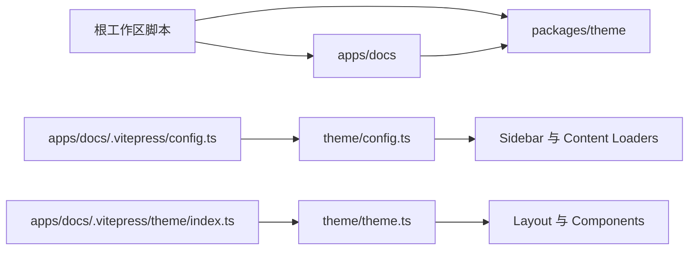

# MtF.Report 仓库架构

本仓库采用 pnpm workspace 管理，将“站点内容”和“VitePress 主题实现”分为两个独立工作区。

```text
MtF.Report/
├── apps/
│   └── docs/                 # MtF.Report 文档站
│       ├── .vitepress/       # 站点配置与品牌样式
│       ├── public/           # 静态资源
│       ├── en/               # 英文内容
│       ├── zh-cn/            # 简体中文内容
│       └── zh-tw/            # 繁体中文内容
├── packages/
│   └── theme/                # 可复用的 VitePress 主题包
│       └── src/
│           ├── components/   # 页面与布局组件
│           ├── plugins/      # VitePress 内容加载器
│           ├── utils/        # 配置上下文与路径工具
│           ├── config.ts     # VitePress 服务端配置入口
│           └── theme.ts      # VitePress 客户端主题入口
├── package.json              # 工作区统一命令
├── pnpm-workspace.yaml       # 工作区声明
└── vercel.json               # 生产部署配置
```

## 依赖方向



依赖只允许从 `apps/docs` 指向 `packages/theme`。主题包不能反向读取站点内容，也不应硬编码 MtF.Report 的文案、品牌资源或部署路径。

## 运行链路

1. `apps/docs/.vitepress/config.ts` 创建站点配置，并通过 `withThemeContext` 把站点参数传给主题配置入口。
2. `packages/theme/src/config.ts` 组装 Markdown 插件、侧边栏、内容统计和 Vite 插件。
3. `apps/docs/.vitepress/theme/index.ts` 加载主题客户端入口。
4. `packages/theme/src/theme.ts` 扩展 VitePress 默认主题并挂载自定义布局与客户端插件。
5. `packages/theme/src/Layout.vue` 将页面信息、版权信息、页脚和辅助阅读组件插入 VitePress 插槽。

## 目录职责

### `apps/docs`

- Markdown 内容、翻译和栏目结构。
- MtF.Report 的颜色、字体、Logo、favicon 等品牌资源。
- 域名、导航、语言、免责声明和部署输出目录等站点配置。

### `packages/theme`

- 通用布局和 Vue 组件。
- VitePress/Markdown/Vite 插件组合。
- 侧边栏生成、内容加载和配置上下文。
- 对外导出的 `config`、`theme`、`components`、`utils` 四个入口。

### 根目录

- 统一开发、构建、检查命令。
- workspace、CI、Vercel 和代码规范配置。
- 项目级说明文档。

## 常用命令

```bash
pnpm install
pnpm dev
pnpm build
pnpm lint
pnpm typecheck
```

`pnpm build` 会先构建主题包，再构建文档站，确保站点始终使用最新的本地主题产物。

## 修改约定

- 新文章和翻译放到 `apps/docs/<locale>/`。
- 品牌样式放到 `apps/docs/.vitepress/theme/style.css`。
- 可被其他站点复用的组件或构建能力放到 `packages/theme/src/`。
- 新增主题公开能力时，同步维护 `packages/theme/package.json` 的 `exports`。
- 调整目录时同步检查 GitHub Actions、Vercel 和内容同步脚本中的路径。
